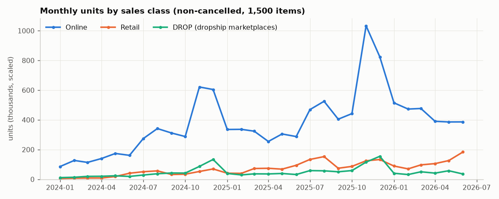
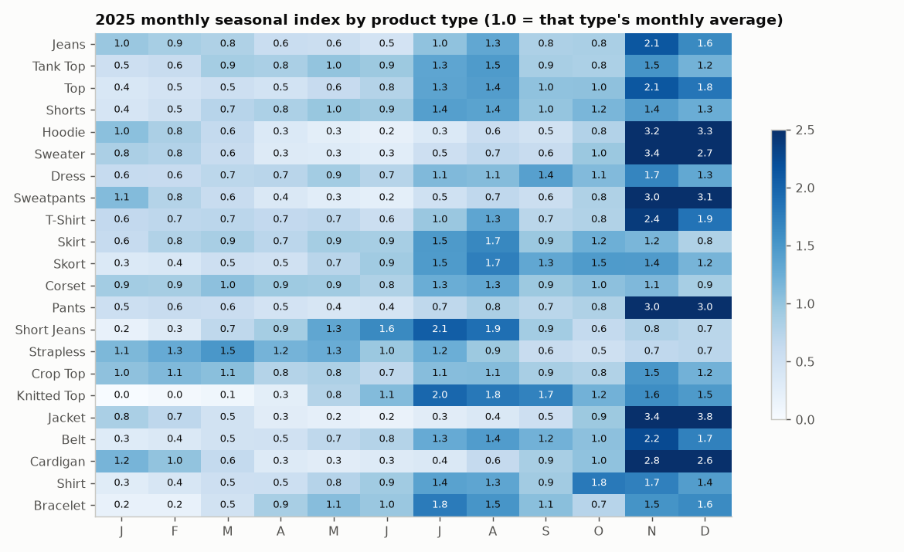
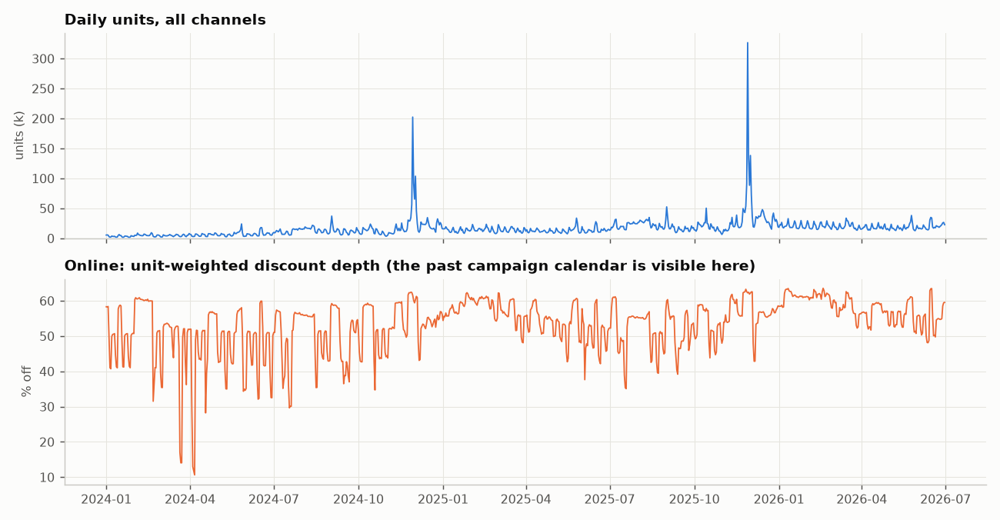
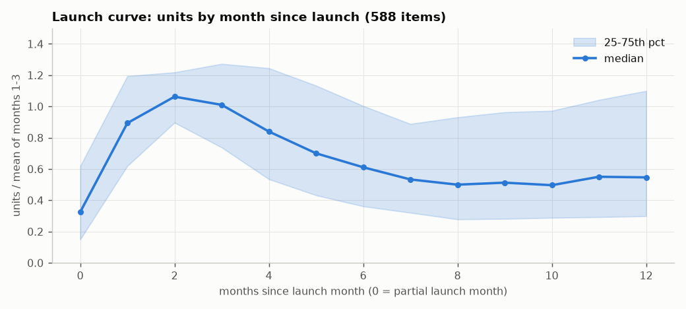
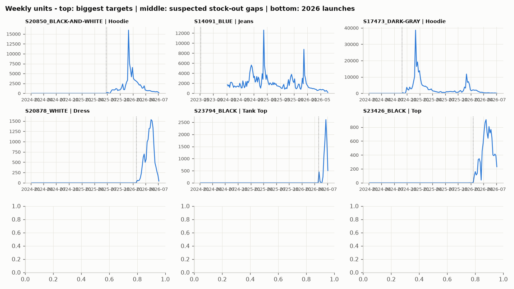

# Edikted demand forecasting — EDA, baselines and modelling recommendations

First pass, ~30 minutes. Everything here is reproducible from the scripts in `eda/` (run with `.venv/Scripts/python`).

## 1. The task in one paragraph

Forecast **monthly units for 100 style-colours for Jul, Aug, Sep, Oct 2026**, from order lines covering Jan 2024 – Jun 2026 (1,500 items, the other 1,400 are there to learn from). Target = `qty_ordered` on non-cancelled lines, all channels, by NY calendar month. Also required: a confidence level 1–3 per item (±20% / ±50% / worse, judged on the **4-month total**), a short explanation for at least 15 items, and a one-page model description. Site-wide campaigns for Jul–Oct 2026 are given.

## 2. Data at a glance

| | |
|---|---|
| Order lines | 15,179,907 (line_id unique), 8.63M orders |
| Items / SKUs | 1,500 style-colours / 6,979 SKUs |
| Period | 2024-01-01 → 2026-06-30, no missing days |
| Units (non-cancelled) | 14.98M; 99.4% of lines are qty 1 |
| Class mix (2026 H1) | Online 74% · Retail 19% · Drop 7% |
| Item-months with zero sales after launch | 0.8% (only 2.8% are below 10 units) |
| Concentration | top 10% of items = 53% of units; the 100 targets = 21% |

Demand is **not intermittent** at the item-month level. This is a level × seasonality × lifecycle problem, not a zero-inflated one.

## 3. Main findings

### Calendar and seasonality

- Shape of the year (2025, untagged items, 1.0 = monthly average): Jan–Jun 0.6–0.7, **Jul 1.0, Aug 1.2, Sep 0.8, Oct 0.85**, Nov 2.25, Dec 2.0. The forecast window opens on the back-to-school peak and then steps down.
- Black Friday is extreme (2025-11-28 = 327k units in one day, ~15x a normal day). It is outside the forecast window but contaminates any "recent level" feature computed over Nov–Jan.
- Day of week: Sunday and Monday are ~20% above average, Wed/Thu ~15% below.
- Seasonal profile differs sharply by product type (figure below). Hoodies, sweaters, sweatpants and jackets are at their trough in June–July (0.2–0.5) and climb steadily to about 0.8–1.0 by October. Short jeans, skirts and skorts peak in July–August (1.5–2.1) and fall back by October. Dresses peak in September (1.4). These indices come from raw type totals, so they include the item-mix effect described in artefact #1 and overstate the second half of the year; read the shape, not the level.

### Discounts and campaigns

- The site is always on sale: the online unit-weighted discount sits at 50–60%. The past campaign calendar is clearly readable from `avg_discounts`.
- Depth moves volume a lot. Online daily units relative to the local 29-day median: **0.51x on days below 45% off, 0.99x at 50–55%, 1.55x at 60–65%** (correlation of deviations 0.51). The planned Jul–Oct 2026 calendar is therefore a real, usable signal.
- Retail lines carry almost no discount (mean 4.5%), so discount information is effectively online-only.

### Lifecycle

- The typical item peaks in months 2–3 after launch, falls to about half by month 7–8, then plateaus. The spread is wide (25th percentile 0.3x, 75th 1.0x at month 8).
- Year-over-year decay is strong for old items: for the 224 items launched before Mar 2024, Jul–Oct 2025 was a **median 0.44x** of Jul–Oct 2024. Last year's same months are a poor forecast on their own.
- Short-term persistence is high: for items with ≥100 units in Mar–Jun 2025, the log correlation with Jul–Oct 2025 is 0.93, but the ratio ranges from 0.52x (p10) to 1.88x (p90). The recent level tells you most of it; the multiplier is where the modelling is.

### Occasion tags (39 of the 100 targets are tagged)
2025 monthly index (1.0 = the tag group's monthly average):

| Tag (targets) | Jul | Aug | Sep | Oct |
|---|---|---|---|---|
| Halloween (14) | 1.31 | 1.39 | 1.16 | **1.78** |
| Homecoming (6) | 0.77 | 1.11 | **2.25** | 1.41 |
| 4th of July (9) | 1.47 | 1.46 | 0.77 | 0.67 |
| Graduation (4) | 1.32 | 1.18 | 1.02 | 0.60 |
| World Cup (3) | no 2025 history — needs judgement |

### The 100 targets
- Age at 1 Jul 2026: 25 are ≤6 months old, 26 are 6–12 months, 26 are 1–2 years, 23 older. **50 have never been on sale during a Jul–Oct**, and 25 launched in 2026.
- Types: tops 13, dresses 12, shorts 11, tank tops 10, hoodies 7, T-shirts 7, pants 6, jeans 5, sweaters 5, swimwear tops 4, others.
- Size: median 2,814 units over the last 3 months (range 1 to 13,359). One item, `S16079_DARK-GRAY`, has not sold since 2026-04-10.
- Channel mix matches the full panel (76% online, 17% retail, 7% drop).

## 4. Data artefacts found (the brief asks for these)

| # | Artefact | Evidence | Proposed treatment |
|---|---|---|---|
| 1 | **Panel is selected on survival** | 1,450 of 1,500 items still sell in 2026 Q2; items enter over time (190 published before 2024, 324 in 2026) | Total units growing from 101k to 605k/month is mostly more items, not brand growth. Never read seasonality or trend off raw totals; use like-for-like cohorts |
| 2 | Mass cancellation event | 2025-10-14: 145k units cancelled (74% of the day), almost all edikted.com; 2025-10-15: 25%. Other months ~1% | Exclude cancelled as instructed; treat 14–15 Oct 2025 as an anomaly when learning October patterns |
| 3 | Retail store roll-out | 1 store in Jan 2024 → 16 by Jun 2026 (plus a 5-day pop-up); retail went from 4.5k to 183k units/month (30% of June 2026) | Store openings are step changes in distribution, not demand. Model retail per store or separately |
| 4 | "DROP" is not bulk wholesale | 1.26 units per order across Pacsun, Nordstrom, Macy's etc. | Treat as dropship marketplace demand; no lumpy B2B handling needed |
| 5 | Channels start and stop | TikTok from 2024-01-31; Flip Jul 2024–Jun 2025; Urban from Apr 2025; Hot Topic 32 units; "BARBIE" pop-up 5 days in May 2026 | Channel-aware features; drop the trivial ones |
| 6 | Launch month is partial | Median first sale is 1 day after publish; month 0 averages 0.32x of months 1–3 | Treat month 0 as partial exposure (scale by days live) rather than as a low month |
| 7 | Sales before the published date | 85 items, up to 176 days earlier | Use min(published, first sale) as the effective start |
| 8 | `published_date` time zone | Stored as midnight Israel time, so it falls on the previous day in NY | Convert before computing age |
| 9 | History is left-censored | 190 items were published before 2024 | Age from published date, not from first row |
| 10 | Item master not constant | Up to 3 product names and 3 product types per style_color | Take the most recent or modal value |
| 11 | Odd discount values | 25.6k lines negative (min −6.2), 7.5k lines ≥ 1.0, 1.62M at exactly 0 (mostly retail) | Clip to [0, 1]; do not use retail discount |
| 12 | Abnormally low days | 2024-05-10 and 2024-10-31 are below 40% of the local median | Likely outage or data gap; minor at monthly grain |
| 13 | Possible stock-outs | 12 items show ≥14 zero days right after ≥3 units/day (several are exactly 14 days); none are targets | Treat as missing, not zero, per the brief |
| 14 | State field mixed | "California" and "CA" both present (retail uses abbreviations) | Not needed for the target |
| 15 | Possible duplicate lines | 2,248 groups share order, SKU and timestamp (4.5k lines, 0.03%) | Negligible; leave in |

## 5. Baseline models

Backtest set up as the real task: stand at the end of a month, forecast the next four. Two origins: **Jun 2025 → Jul–Oct 2025** (the exact analogue) and **Feb 2026 → Mar–Jun 2026**. Metrics are on the 4-month total per item, matching the confidence scale.

| Model | Jun-25 origin (765 items): WAPE / bias / within ±20% / within ±50% | Feb-26 origin (1,275 items): WAPE / bias / within ±20% / within ±50% |
|---|---|---|
| B1 Flat: mean of last 3 months | 0.41 / −25% / 26% / 69% | 1.04 / +59% / 20% / 44% |
| B2 Seasonal naive (same months last year) | 0.57 / +4% / 20% / 53% | 0.96 / +55% / 15% / 37% |
| B3 Last 3 months × type seasonal ratio | 0.79 / +66% / 16% / 35% | 0.63 / +27% / 24% / 54% |
| **B4 LightGBM, pooled, log-ratio target** | **0.37 / −25% / 29% / 73%** | **0.39 / −25% / 26% / 66%** |
| B5 50/50 blend of B3 and B4 | 0.45 / +21% / 26% / 53% | 0.44 / +1% / 30% / 64% |

On the subset of the 100 targets that were live at each origin (47 and 85 items), B4 scores WAPE 0.44 and 0.37, with 68% and 71% within ±50%.

What the baselines say:
- **The pooled gradient-boosted model is the only one that is stable across both folds** (WAPE 0.37–0.39). Flat works in June only by luck of the calendar and fails badly from a February origin, because the recent level still contains the holiday peak.
- **B4 under-forecasts by 25% in both folds.** I first read this as a systematic effect of the median loss. **That reading was wrong**: over 13 origins the bias averages about zero and swings ±17% from origin to origin (section 9).
- **Seasonal naive and the raw type ratio are badly biased upward**, which is artefact #1 and the lifecycle decay showing up in numbers.
- **Only 26–30% of items land within ±20% and about 70% within ±50%.** That is the honest prior for the confidence column: few items deserve a 1.
- Top LightGBM drivers by gain: target month, product type, recent trend (last month vs last 3), type seasonal ratio, age.

B4 is deliberately small: 6 monthly lags, age, product type, target month, horizon, colour number, six occasion flags and a shrunk prior-year type seasonal ratio. It uses no discounts, campaigns, channels, weekly data or `item_attributes.csv` yet.

## 6. Top 10 recommendations for the model

1. **Validate exactly the way you will be judged.** Rolling-origin backtest, 4-month horizon, scored on the 4-month total per item with share within ±20% / ±50%, WAPE and bias. Keep Jun 2025 → Jul–Oct 2025 as the primary fold and add several other origins so a model that only works in one season is caught (the flat baseline is the cautionary example).
2. **One pooled model across all 1,500 items, with a scale-free target.** Half the targets have never seen a Jul–Oct and 25 are under six months old, so per-item time-series models have nothing to fit. Predict the ratio of future month to recent level and let the other 1,400 items teach the multiplier.
3. ~~Fix the −25% bias before adding features by switching to a mean-unbiased loss.~~ **Withdrawn after the 13-origin test in section 9**: Tweedie and squared-error losses were worse than the median loss, and the bias is not systematic. See the revised list in section 10.
4. **Estimate seasonality like-for-like, never from raw totals.** Because the panel is selected on survival and items are added over time, raw type totals mix "more items" with "more demand". Build seasonal indices from items live in both windows, pooled by type and by attributes such as fabric weight, with shrinkage for small groups. There are now two Jul–Oct seasons to use.
5. **Model the lifecycle explicitly.** Age, months since launch, position on the launch curve, colour number (original versus later colour), and for young items a prior from similar past launches matched on type and tagger attributes. Decay after month 3 is the main thing a 2026 launch will do over the next four months.
6. **Feed the model weekly information even though the output is monthly.** The last 4–8 weeks' run-rate, a correctly scaled partial launch month, and the fact that June 2026 ends inside the Summer Sale (it started 28 June) are all invisible in monthly lags.
7. **Use the planned campaign calendar.** Reconstruct past campaigns from online `avg_discounts`, then describe each month by the share of days at each depth tier. Depth moves daily volume from 0.5x to 1.55x, and Jul–Oct 2026 has a known schedule. Compare it with the same months in 2024 and 2025 so the model learns the difference, not just the level.
8. **Interact occasion tags with the target month.** Halloween items peak in October (1.8x), Homecoming in September (2.3x), 4th of July items fall away from September. World Cup items have no history; the 2026 tournament ends on 19 July, so they need a judgement-based decay and a confidence of 3.
9. **Separate the channels, at least as features.** Online, retail and drop behave differently. Retail is now 30% of units and is driven by the number of open stores, with five stores opened since mid-April 2026 (three of them since 31 May); it also has no discount signal. A retail forecast per store-month, or a store-count feature, avoids reading roll-out as demand.
10. **Clean first, then quantify uncertainty and keep a simple challenger.** Apply the treatments in section 4 before training (cancelled lines, the 14 Oct 2025 event, partial launch months, suspect zero runs as missing). Derive confidence 1–3 from backtest error by segment or from quantile models rather than by feel. Blend the boosted model with a transparent structural baseline, and log every manual adjustment against the raw model total, as the workbook asks.

## 7. Not done yet

- ~~No forecast for Jul–Oct 2026 has been produced.~~ Done in Part 4: `Edikted_Forecasting_Exercise_filled.xlsx`.
- Stock-out detection is a single crude rule; size-level availability was aggregated but not analysed.
- No hyper-parameter tuning; every model uses one fixed LightGBM configuration.
- Retail has not been modelled per store, and the campaign calendar is not yet inside the model (section 9 explains why it probably cannot be).

## 8. Files

| Path | What it is |
|---|---|
| `eda/00_read_assignment.py` … `eda/05_baselines.py` | Scripts, in run order |
| `eda/eda_output.txt`, `eda/baselines_output.txt` | Full printed output |
| `eda/figs/` | The five charts above |
| `data/monthly_item.parquet` | Item × month units (non-cancelled), the modelling panel |
| `data/daily_item_chan.parquet` | Item × day × channel aggregates with discount and size counts |
| `data/targets_overview.csv` | The 100 targets with age, recent sales and last-year sales |
| `data/backtest_2025-06.csv`, `data/backtest_2026-02.csv` | Per-item backtest predictions and actuals |
| `data/suspected_stockouts.csv` | Items flagged by the zero-run rule |
| `eda/06_features.py` → `data/features.parquet` | Origin-anchored feature table, one row per item × origin × horizon |
| `eda/07_m5_experiments.py`, `eda/10_round2.py` | 13-origin tests of the M5 ideas; output in `eda/m5_experiments_output.txt`, `eda/round2_output.txt` |
| `eda/08_confidence.py` | Error by segment and the error-prediction test; output in `eda/confidence_output.txt` |
| `eda/09_campaigns.py` | Past Jul–Oct campaign calendars versus the 2026 plan |
| `data/best_backtest_preds.parquet` | Out-of-sample predictions of the best model for all 13 origins |

---

# Part 2 — After the M5 summary

## 9. Which M5 lessons hold on this data

I tested the transferable ideas instead of adopting them. Set-up: 13 rolling origins (Feb 2025 to Feb 2026), each forecasting the next four months, scored on the 4-month total per item. The feature table is origin-anchored with the horizon as a feature (the design the summary recommends for long horizons). Models are judged on mean and spread across origins.

### Results (all live items, mean over 13 origins)

| Model | WAPE mean | WAPE std | Worst origin | Bias mean | Bias std | Within ±20% | Within ±50% |
|---|---|---|---|---|---|---|---|
| Flat 91-day run-rate | 0.690 | 0.320 | 1.310 | +22% | 0.49 | 21% | 49% |
| **Median loss (L1 on log ratio), base features** | 0.377 | 0.082 | 0.559 | −2% | 0.17 | 32% | 68% |
| Squared loss on log ratio + smearing | 0.433 | 0.099 | 0.620 | +15% | 0.21 | 28% | 60% |
| Tweedie on units, level as offset | 0.434 | 0.110 | 0.668 | +15% | 0.20 | 27% | 58% |
| Tweedie, one model per horizon (direct) | 0.455 | 0.189 | 0.994 | +12% | 0.27 | 29% | 63% |
| Tweedie, separate models per category group | 0.424 | 0.156 | 0.904 | +11% | 0.23 | 30% | 65% |
| Median loss, all features | 0.366 | 0.091 | 0.532 | −7% | 0.20 | 32% | 69% |
| **Average of median-loss base and all-features models** | **0.363** | 0.086 | 0.539 | −4% | 0.18 | **33%** | **70%** |
| Upper bound: a mixed-loss ensemble rescaled to each origin's true total (not achievable) | 0.352 | 0.068 | 0.504 | 0% | 0 | 32% | 68% |

On the 100 targets alone the best model scores WAPE 0.371, 34% within ±20% and 74% within ±50%.

### Verdict per M5 lesson

| M5 lesson | Verdict here | Evidence |
|---|---|---|
| Global pooled gradient boosting | **Holds** | 0.36–0.38 versus 0.69 for the run-rate baseline |
| Validate on many windows, judge mean and spread | **Holds, and it changed my conclusions** | Two folds suggested a systematic −25% bias; 13 folds show bias of about zero on average with ±17% swings |
| Tweedie loss | **Does not transfer** | Beat the median loss in only 2 of 13 origins. Demand here is not intermittent (0.8% zero item-months), and the score is a percentage error on each item's total, which a median targets better than a mean. The M5 metric was squared error, which is why the mean mattered there |
| Direct model per horizon bucket | **Does not transfer** | Least stable variant of all. With 13k–50k training rows, splitting by horizon costs more than it gains. One model with horizon as a feature is already recursion-free |
| Partial pooling (models per group) | Neutral | Slightly better mean, clearly worse spread |
| Equal-weight ensembles | **Holds, modestly** | Averaging two good models wins in 10 of 13 origins. Adding weaker members (Tweedie, squared loss) makes the average worse |
| Rich features | Mostly neutral | Like-for-like seasonality halved the bias of the mean-targeting models. Recent run-rate, channel mix, item discount and tagger attributes each added nothing measurable; together they add about 0.01 WAPE |
| Top level and bottom level are separate problems | **Holds, with a twist** | Given the true total for every origin, a mixed-loss ensemble improves only from WAPE 0.395 to 0.352, and its ±20% hit rate only from 30% to 32%. Item-level noise dominates |
| Multipliers anchored to something independent | **Does not transfer** | Rescaling to last year's like-for-like multiplier raised bias to +17% |
| Recency weighting | Neutral | No gain from up-weighting or restricting to recent origins |

Not testable with the data provided: stock-out de-censoring (no inventory), item-level price scenarios (no future prices), size curves and returns (outside the brief). Not attempted: image embeddings and deep or foundation models; with 30 months of history and the item-noise ceiling above, a gain looks unlikely.

### Why last year is a poor anchor: the multiplier drifts

Realised multiplier = units over the next four months ÷ (4 × recent monthly level), all live items:

| Origin month | 2024 | 2025 | 2026 |
|---|---|---|---|
| March | 1.45 | 0.86 | |
| April | 1.52 | 1.08 | |
| May | 1.56 | 1.20 | |
| **June** | **1.47** | **1.31** | to forecast |
| July | 1.29 | 1.21 | |
| January | | 0.52 | 0.47 |
| February | | 0.58 | 0.60 |

The 2024 values are inflated because the panel's 2024 items are young winners that survived to 2026. For items at least a year old the June multiplier is steadier: 1.12 in 2024 and 1.22 in 2025. This is useful for the real task: a June-origin forecast whose total for mature items sits far outside roughly 1.1–1.3× the recent level needs a reason.

### The campaign calendar: 2026 is heavier than either past year

Days per month with the edikted.com unit-weighted discount at or above 58.5%, against days inside a planned deep campaign (everything in the plan except Back to School):

| | Jul | Aug | Sep | Oct |
|---|---|---|---|---|
| 2024 actual | 0 | 0 | 3 | 8 |
| 2025 actual | 6 | 0 | 3 | 12 |
| 2026 plan | 19 | 8 | 12 | 12 |

Past deep runs sold 1.2–2.4× the surrounding daily median. The comparison is approximate: the threshold is mine, and a headline of "50–80% off" may not translate into the same realised depth (July 2025 also had 12 days at 56–60%). With two past seasons the model cannot learn this effect, because a calendar feature is indistinguishable from the month itself. It therefore has to enter as an explicit, documented adjustment, which is also what the M5 summary advises for level shifts.

### Can we tell in advance which items will be forecast well? Only weakly

An error model trained only on origins whose actuals were already known, then scored on later origins, has a rank correlation of 0.11 with the real error.

| Predicted tier | Share of items | Within ±20% | Within ±50% |
|---|---|---|---|
| Best | 10% | 40% | 82% |
| Middle | 52% | 35% | 76% |
| Worst | 38% | 31% | 67% |

Simple segments separate about as well:

| Segment | Within ±20% | Within ±50% |
|---|---|---|
| Recent level above 3,000 units/month | 49% | 82% |
| Dresses | 41% | 80% |
| Occasion-tagged | 39% | 80% |
| All items | 33% | 71% |
| Hoodies, sweaters, jackets, sweatpants | 31% | 64% |
| Under 3 months old | 29% | 63% |
| Recent level under 100 units/month | 28% | 64% |

No segment reaches a 50% chance of landing within ±20%.

## 10. Revised top 10 recommendations

1. **Keep one pooled LightGBM, origin-anchored, with the horizon as a feature.** Do not split it by horizon or by category.
2. **Train on the median (absolute error on the log ratio to recent level), not Tweedie.** It matches a percentage-error score on non-intermittent demand and was the most stable choice across 13 origins.
3. **Judge every change on 13 rolling origins, by mean and spread.** Differences under about 0.02 WAPE are noise. Keep the June 2025 origin as the closest analogue, but never decide on it alone.
4. **Ship a two-model average** (base features and all features, both median loss). Do not add weaker members for the sake of diversity.
5. **Sanity-check the overall level instead of modelling it.** Compare the forecast total for mature items with the 1.1–1.3× range seen from June origins. Do not rescale to last year.
6. **Apply the 2026 campaign calendar as an explicit adjustment and record it in the "model raw total" column.** It is the one known difference between 2026 and the history, and the model cannot see it. Size it conservatively, since some deep-discount volume is pulled forward from neighbouring days.
7. **Keep like-for-like seasonality, and never use raw totals or last year's same months as an anchor.** The drift table shows how far survival selection distorts them.
8. **Keep lifecycle and occasion × month effects in the model; handle World Cup items by judgement.** They have no history and the tournament ends on 19 July 2026.
9. **Assign confidence from the backtest, and be sparing with 1s.** Default to 2. Use 3 for items under three months old, under 100 units a month, World Cup items, the item that stopped selling in April, and the worst tier of the error model. Reserve 1 for a handful of high-volume, stable, tagged items, and say in the workbook that even these land within ±20% only about half the time.
10. **Stop spending effort on what did not pay:** Tweedie, per-horizon models, per-category models, recency weighting, last-year anchoring and tagger attributes. Spend it on the explanations, the campaign adjustment and a per-item review of the largest targets, where judgement can still add something the model cannot.

---

# Part 3 — After the broader competition review

Every decision is now recorded in `log.md` (append-only, entries D001–D029). The model specification did not change in this round: each new idea was tested on the same 13 origins and none cleared the noise band.

## 11. Verdict on each idea from the review

| Idea from the review | Verdict | Evidence |
|---|---|---|
| The model must beat "recent level × category seasonal ratio × age decay" | **Passed** | Structured baseline WAPE 0.419, ensemble 0.345 on the 8 origins where the baseline can be built; ensemble wins 7 of 8 |
| Blend with that baseline as insurance | Not adopted | 75/25 blend 0.343 versus 0.345, bias worsens from −10% to −15% |
| Treat stock-out zeros as missing | Not needed globally | Improbable zero runs hide about 0.4% of units; broken core sizes about 0.1% of online units. Two targets handled individually: S16079_DARK-GRAY (no sales since 10 April) and S14995_NAVY (about 15% lost to a missing size) |
| Launch-curve analogs for young items | Rejected | WAPE 0.500 versus 0.381 on the same young items; never won an origin |
| Top-down category total × item share | Not built separately | With a fixed item set per origin it is the same calculation as the structured baseline |
| Style and sibling-colour features | Not added | 0.361 as a third ensemble member versus 0.363; inside the noise band |
| Downward shade for relative-error scoring | Rejected | Fitted multiplier came out at 0.80–0.84 and made later origins worse (WAPE 0.345 → 0.364). The hit-rate curve is flat from 0.85 to 1.00 and the best single-origin value ranges from 0.72 to 1.24 |
| Forecast DROP separately as lumpy B2B | Not applicable | DROP here is marketplace dropship at 1.26 units per order, not bulk |
| Winsorise bulk lines, remove test orders | Not needed | Lines of 5+ units are 9.2k units of 15.0M; lines at 100% discount are 7.5k of 15.2M |
| Aim at the median | Already in place | Median loss adopted in round 2 |
| Several backtest origins | Already in place | 13 origins |
| Confidence from backtest hit-rate models with ensemble disagreement | Adopted, with a caveat | Ranking works modestly (top decile 38% within ±20% and 81% within ±50%; bottom decile 24% and 60%), but no group reaches 50% within ±20% |

## 12. What this means for the forecast

- **Model:** unchanged. Average of two pooled median-loss LightGBMs, origin-anchored, horizon as a feature (WAPE 0.363 over 13 origins; 0.371 on the targets).
- **Per-item sanity check:** the structured baseline, which can be built for the June 2026 origin. Large gaps between it and the model are candidates for the explanation column.
- **Judgement cases, each to be recorded against the raw model total:** the three World Cup items (published 25 May 2026; 6,685 / 928 / 2,584 units in June; the tournament ends 19 July), the heavier 2026 campaign calendar, S16079_DARK-GRAY and S14995_NAVY.
- **Confidence:** default 2; 3 for the bottom score decile, items under three months old, items under 100 units a month, the World Cup items and S16079_DARK-GRAY. A confidence of 1 is not supported by the backtest for any identifiable group, so any 1s would be a deliberate exception.

New files: `log.md`, `eda/11_censoring.py`, `eda/12_round3.py`, with outputs in `eda/censoring_output.txt` and `eda/round3_output.txt`.

---

# Part 4 — The Jul–Oct 2026 forecast

Delivered in `Edikted_Forecasting_Exercise_filled.xlsx`; the original workbook is untouched. Decisions D030–D040 are in `log.md`.

## 13. Result

| | Jul | Aug | Sep | Oct | Total |
|---|---|---|---|---|---|
| Final forecast, 100 items | 155,784 | 156,747 | 106,844 | 109,343 | 528,718 |

Raw model total 537,977; adjustments take it down by 1.7%. For scale, June 2026 × 4 for the same items is 481,972.

| Category group | Raw model | Final |
|---|---|---|
| top | 212,969 | 201,925 |
| bottom | 191,952 | 191,905 |
| warm | 77,853 | 78,934 |
| dress | 44,120 | 44,675 |
| swim | 9,592 | 9,763 |
| other | 1,490 | 1,516 |

## 14. What was adjusted and why

- **Campaign calendar (all items, +0.4% to +2.5%).** Replaying the planned 2026 windows on past data showed that the Labor Day sale, the October sale and the 4th of July push already ran on the same dates in 2024 and 2025. Only the August Clearance and the late-September sale look new. They add +7% to August and +4% to September on each item's edikted.com share; this is half the measured deep-discount lift, because realised depth is uncertain. This corrects my earlier claim that 2026 was much heavier than past years.
- **World Cup items (−29%, −59%, −34%).** July is set from the late-June daily pace up to the 19 July final, then reduced; August–October follow the measured post-event decay of past 4th of July and St. Patrick's items.
- **S16079_DARK-GRAY.** No sales since 10 April. Forecast as in stock, per the brief, at 130 units.

## 15. Confidence

Two items get a 1 (Roman Low Rise Baggy Jeans and Rhian babydoll top). In the backtest, high-volume items where the model and the structured baseline agree landed within ±20% 56% of the time. Eleven items get a 3: launches under three months old, items under 100 units a month, the World Cup items and the out-of-stock item. The other 87 get a 2.

## 16. Main risk

At last June's origin the model under-forecast by about 14%, and this year its multiplier for mature items (1.04× recent level) is again below what the last two Junes delivered (1.12× and 1.22×). Rescaling hurt across the backtest, so the forecast is left as is. If July–October repeats 2025, the total could be 10–15% higher. This is stated in the "Where it is weak" box.

---

# Part 5 — Quantile model, bias-configured answer, IQR confidence

Requested on 12 Nov 2026. Decisions D042–D048 in `log.md`; scripts `eda/20_quantiles.py`, `eda/21_quantile_eval.py`, `eda/22_quantile_final.py`, `eda/23_fill_workbook_q.py`.

## 17. What changed

| | Before (D013, D035) | Now (D042–D046) |
|---|---|---|
| Model behind the answer | Median of each month, summed | Quantiles of the 4-month total (10th–90th percentile) |
| Answer | Median | 61st percentile: zero total bias on the June 2025 – February 2026 origins |
| Interval | None | Calibrated P25–P75 (widened 1.3×, covers 50%) and P10–P90 (covers 80%) |
| Confidence | Backtest segment rules | Where the calibrated P25–P75 sits against the ±20% and ±50% bands around the answer |
| Confidence counts | 2 / 87 / 11 | 3 / 41 / 56 |
| Total, Jul–Oct 2026 | 528,718 | 613,874 |

## 18. Evidence

- **Point accuracy (nine origins, June 2025 to February 2026):** quantile median WAPE 0.322 against 0.342 for the previous model, better in 7 of 9 origins. Over all 13 origins the quantile model is worse (0.403) because the earliest folds have too little training data.
- **Choosing the answer from bias:** aggregate bias is −9.9% at the median and zero at the 61st percentile. The cost is small per item: within ±20% goes from 35.8% to 33.9% and WAPE from 0.329 to 0.343. Bias still swings from −20% to +13% between origins. When the quantile is chosen at each origin from earlier origins only, it does worse, because those earlier folds over-forecast. The 61st percentile is therefore an in-sample choice.
- **Calibration:** raw P25–P75 covered only 40% of actuals. Widening by 1.3× gives 50.2%, and P10–P90 then covers 79.8%.
- **Confidence from the IQR:**

| Level | Share of backtest forecasts | Within ±20% | Off by more than 50% |
|---|---|---|---|
| 1 | 4.3% | 56.1% | 7.3% |
| 2 | 42.4% | 40.6% | 20.9% |
| 3 | 53.3% | 26.7% | 40.4% |

This separates items far better than the earlier error model, whose top and bottom deciles landed within ±20% 38% and 24% of the time.

## 19. Result

Final total 613,874 (raw answer 638,916; sum of medians 574,450; calibrated P25 and P75 summed 415,319 and 820,249, which is not a portfolio interval). The mature-item multiplier of 1.20 now matches the 1.12–1.22 realised from the last two June origins. Confidence 1: S14857_BLUE-WASHED, S15999_BLUE, S17159_BLACK-WASHED.

---

# Part 6 — Common-sense audit

Goal set on 12 Nov 2026: check that the outputs do not contradict common sense. Decisions D050–D057 in `log.md`. The final forecast is now `data/final_forecast_q3.csv` (`eda/32_final_v3.py`).

## 20. What the audit found and changed

| Finding | Evidence | Change |
|---|---|---|
| The 61st-percentile answer was tuned on Black Friday windows | Zero-bias quantile 0.70 at the Sep/Oct 2025 origins, 0.50 at the June and July origins that match this task | Answer back to the median (D050) |
| Swimwear over-forecast, Homecoming and Halloween peaks missed | Summer 2025 origins: swimwear +140%, Homecoming −28%, Halloween −12%; forecast Jul–Oct/June for swimwear 3.0× against 1.55–2.0× in 2024–25 | Swimwear cap 1.82× June; Homecoming and Halloween floors 6.31× and 6.86× June for younger items; segment monthly shapes. Tested on the June 2025 origin with 2024 rules: swimwear +133% → +9%, Homecoming −27% → −10% (D051, D053) |
| Mature items contradicting their own steady trend | Kiara dress at 34% of last year while running at last year's level; scarf running 2.4–3.7× last year but forecast with October below last October | 50/50 blend of model and own trend (last year × year-on-year change × 0.84 ageing). Backtest: within ±20% 38% → 43%; at June/July origins 30% → 44% (D052) |
| Confidence 1 where two good estimates disagree | Blend hit rate within ±20% falls to 31–37% when model and own trend differ by more than 50% | At least confidence 2 above 50%, and 3 above 100% (D055) |

## 21. Checked and left alone

- **Young launches:** none is forecast above the 95th percentile of what comparable launches did; 46% of 1–3-month-old items beat their best month over the next four.
- **Items fading in June:** over the recent origins they are not over-forecast. Event items that fade in June still rebound for their season.
- **Mature items:** their seasonal lift is ×0.88 of last year's, matching the measured ageing effect (×0.84).
- **A general correction toward each item's own seasonality:** no out-of-sample gain; the apparent signal was a regression artefact.

## 22. Result

Final 583,585 units: July 165,267, August 170,700, September 123,661, October 123,957. The sum of model medians is 574,576 (column N); the previous version was 613,874. Confidence 1 / 2 / 3: 2 / 63 / 35.

Every segment's Jul–Oct/June ratio and monthly shape now sits inside or at the edge of its 2024–2025 range:

| Segment | 2026 forecast | History |
|---|---|---|
| Swimwear | 1.72 | 1.55–2.00 |
| Halloween | 7.29 | 6.91–8.01 |
| Homecoming (item median) | 6.39 | 6.31–6.45 |
| 4th of July | 3.71 | 3.26–3.69 |
| Untagged | 4.73 | 5.14–5.46, falling about 6% a year |

July sits slightly below history relative to June (1.37 against 1.47–1.54); the young and fading items explain that.

---

# Part 7 — Forecast checks after the audit (D058–D063)

The questions raised during the audit were answered by backtest checks of the production method, mostly at the origins that match this task (June and July 2025). Scripts: `eda/34_final_consistency.py`–`eda/43_floor_level_two_origins.py`. The final forecast is now `data/final_forecast_q4.csv`.

## 23. What changed

| Check | Evidence | Change |
|---|---|---|
| July allocation | At June 2025 the method's Jul–Oct total was right (−0.4%), but July was 4.2% low (July share 0.281 against 0.293; items 12 months and older −8%, launches −7%) | July share recalibrated by age group, item totals unchanged (D061) |
| Floor level | At the July 2025 origin a median floor overshot (Homecoming +39%, Halloween +24%), although the model was again low. Across both origins the 30th percentile works best (Halloween mean WAPE 0.225 against 0.275 at the median and 0.296 for the model) | Floors = 30th percentile of 2025 items: Homecoming 6.15× and Halloween 5.51× June, down from 6.31× and 6.86× (D063) |
| Atlas page | Rendering in a real browser engine showed every dynamic section blank (duplicate `id="data"`) | Fixed; published file rendered and verified (D059) |

## 24. Checked, no change

- **Items 3–12 months old sit about 10% below 2025 peers.** Forecasting them at the peer ratio would have been worse at three of four origins from May to August 2025: mean bias +14.7% against +4.4% for the model, WAPE 0.450 against 0.372.
- **Mature items at 0.55× last year (item median).** This comes from the 50/50 blend, not from trend × ageing alone. Over eight origins the blend's bias was within ±10% at seven, −2.1% on average. At June 2025 it predicted 0.604× the previous year and the items achieved 0.604×; at July 2025, 0.606× against 0.614×.
- **Workbook.** Every explanation was checked automatically against its cells: totals, model answer, confidence and stated peak months. No inconsistencies.

## 25. Result

Final 580,968 units: July 168,399, August 168,366, September 121,927, October 122,276. Confidence 1 / 2 / 3: 2 / 64 / 34.

July/June is 1.40 overall, against 1.48–1.51 for the same item mix at 2024–25 group ratios. What keeps it lower:

- the World Cup items, held to their late-June pace by the tournament-end rule;
- swimwear, which falls from July;
- the level of items 3–12 months old, which the peer-ratio test above supports.

Items 12 months and older are at 1.49, inside their 1.34–1.56 history.
